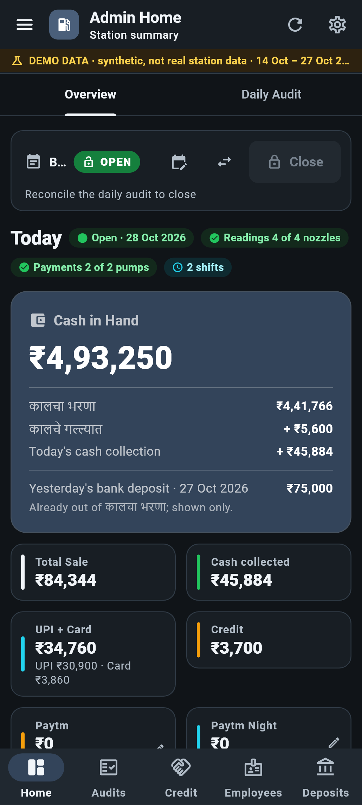
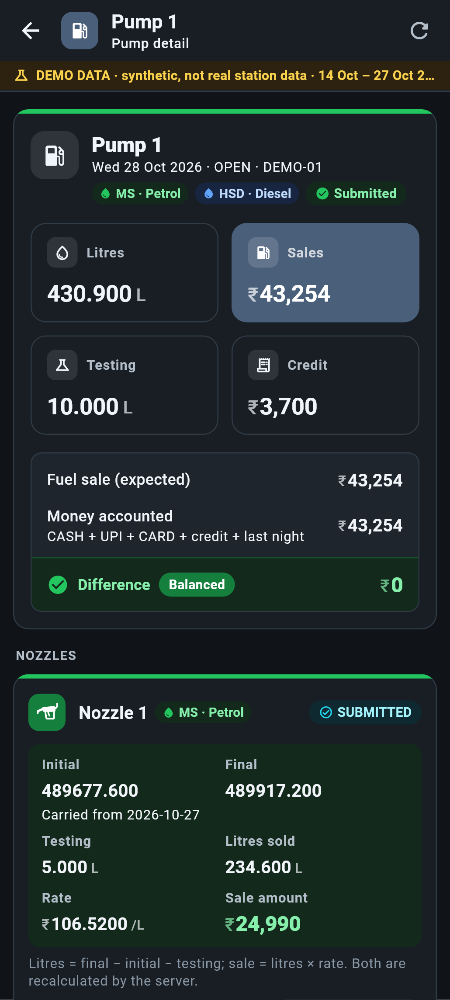
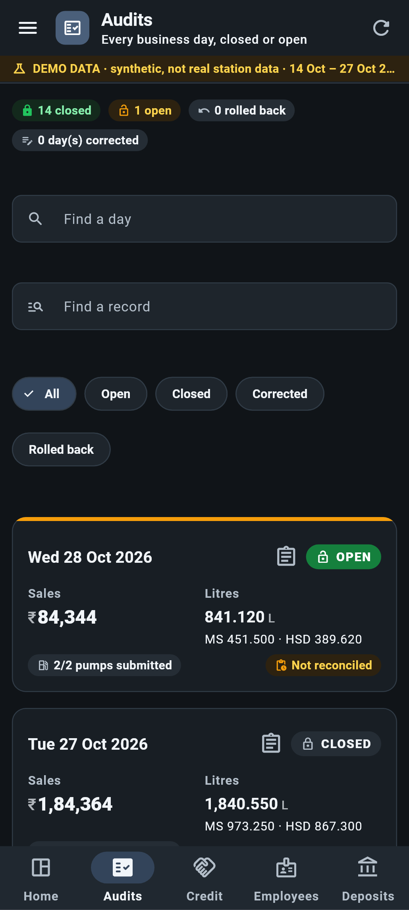
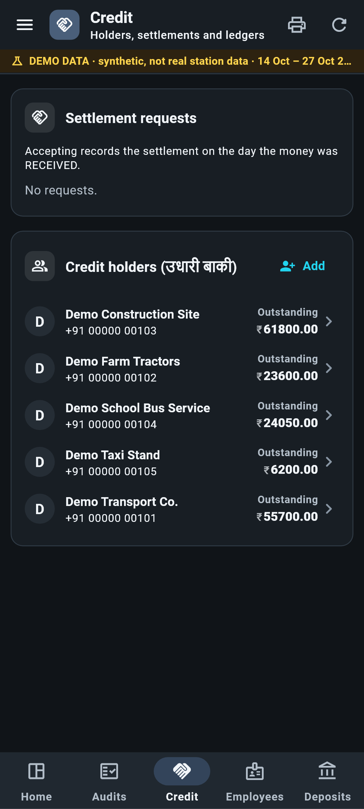
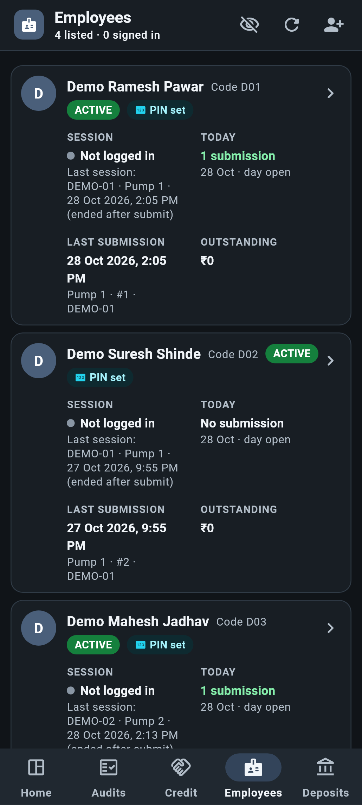
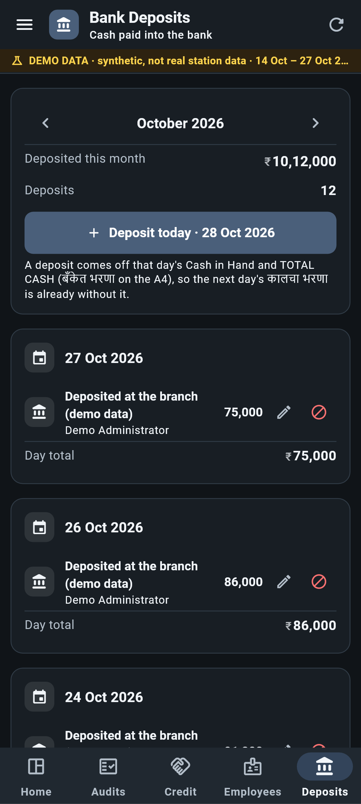
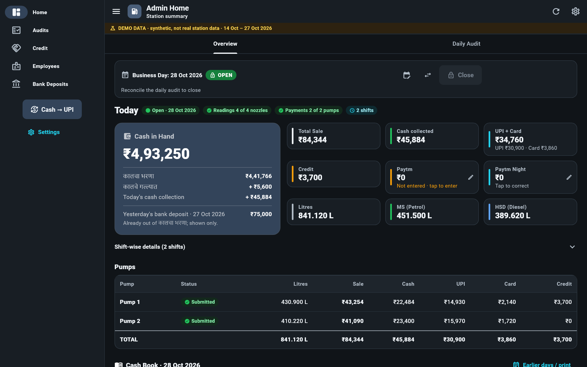
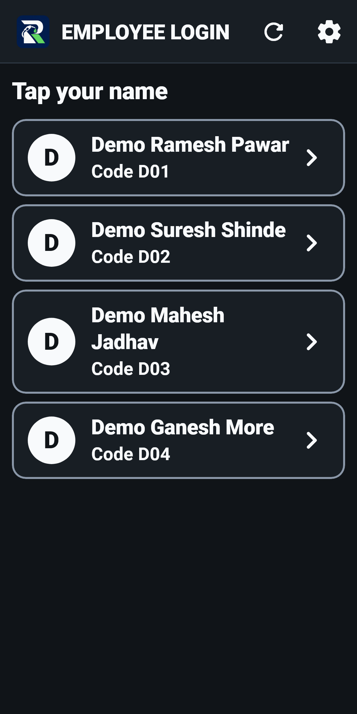
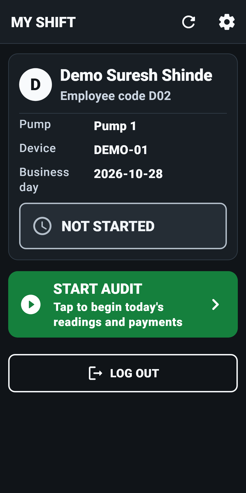

# Fule Management — Petrol Pump Management System

**Presented by Raghav Studio**

A complete digital system for running a petrol pump: an app for the pump staff, an
app for the owner, and a secure server that keeps every number in one place. It is
in daily use at a working fuel station.

This repository is the **live demo**. It runs on sample data, so you can try every
screen without risk.

---

## What it solves

Most fuel stations still run on paper registers, a calculator and trust. That costs
money every day:

| The problem at the pump | What Fule Management does |
|---|---|
| Meter readings copied by hand, totals added on a calculator | Staff enter the opening and closing meter readings; litres and sale amount are calculated automatically, rate by rate, nozzle by nozzle |
| Cash short at the end of a shift and nobody knows who or why | Every shift is tied to the employee who signed in. Cash, UPI, card and credit are matched against the fuel sold, and any difference is shown at once |
| Credit (उधारी) customers kept in a notebook | Each credit customer has a ledger: every sale, every payment, the balance owed, printable at any time |
| Paytm / UPI totals that never match the register | The station's UPI is entered against the day and checked against what the staff recorded |
| No idea how much fuel is really in the tank | Daily tank stock with dip readings, tanker refills and the variance between book stock and actual stock |
| The daily audit sheet takes an hour | The A4 daily audit — कालचा भरणा, कालचे गल्ल्यात, today's collection, bank deposits, TOTAL CASH — is built automatically and printed in one tap |
| The owner has to be at the pump to know what is happening | The owner sees every shift, every pump and the cash in hand live, from a phone or a Windows PC, anywhere |

---

## The apps

### Fule POS — for the pump staff
Runs on Android POS terminals (with a built-in thermal printer) or any Android phone.

- Each employee signs in with their own code and PIN on the pump's device
- Enter closing meter readings and testing litres for each nozzle
- Record credit sales to registered customers
- Enter cash, UPI and card collected; the app shows the difference before submitting
- Final submit prints the shift slip

### Fule Admin — for the owner / manager
Runs on Android phones and Windows PCs.

- **Home:** today's sale, cash in hand, UPI, card, credit, litres by fuel, pump by pump
- **Pump detail:** every nozzle's readings, testing, rate and sale, and whether the money balances
- **Audits:** every business day, open or closed; the full daily audit and the A4 print
- **Credit:** customers, outstanding balances, settlements and ledgers
- **Employees:** who is signed in, shifts submitted, amounts owed
- **Bank Deposits:** cash paid into the bank, by day and month
- Open and close the business day, set fuel rates, correct a mistake with a recorded reason

Every correction is kept in an audit trail: who changed what, when, and why.

---

## Screenshots

*All screenshots show the demo's sample data.*

### Owner app (phone)

| Home | Pump detail | Audits |
|---|---|---|
|  |  |  |

| Credit customers | Employees | Bank deposits |
|---|---|---|
|  |  |  |

### Owner app (Windows PC)

### Staff POS app

| Employee sign-in | My shift |
|---|---|
|  |  |

---

## Try the demo

The demo has **two weeks of sample data**: two pumps (petrol and diesel on each),
four employees working morning and evening shifts, credit customers, expenses,
UPI, bank deposits and tanker refills. **Today's business day is left for you to
open**, so you can run a full day yourself.

### 1. Get your demo login

Contact **Raghav Studio** (details below). You will receive:
- the demo server address
- the owner app login
- the POS device codes and employee PINs

### 2. Install the apps

Download the newest versions from the
**[releases page](https://github.com/YashJadhav11111/fule-releases/releases)**:

| App | File to download | Install on |
|---|---|---|
| Fule Admin (owner) | `fule_admin-…-arm64-v8a.apk` | Android phone |
| Fule Admin (owner) | `FuleAdminSetup-….exe` | Windows PC |
| Fule POS (staff) | `fule_device-…-armeabi-v7a.apk` | Android POS terminal or phone |

On Android, the phone may warn that the app is not from the Play Store. Tap
**More details → Install anyway**. The apps update themselves when a new version
is released.

### 3. Point the apps at the demo server

**Before signing in**, open **Settings** in each app and enter the demo server
address you received. In the POS app, also enter the device code (for example the
one for Pump 1).

### 4. A suggested walkthrough (15 minutes)

1. **Owner app:** sign in. Look around Home, then open **Audits** and tap a past
   day to see the full daily audit. Check **Credit** and **Bank Deposits**.
2. **Owner app:** on Home, **open today's business day** (the rates and pump
   assignments are carried over from yesterday).
3. **POS app:** tap an employee's name, enter their PIN and start the shift.
   Enter the nozzle readings, a credit sale if you like, then cash / UPI / card,
   and submit.
4. **Owner app:** pull to refresh. The shift appears on Home and on the pump's
   page, already checked against the fuel sold.
5. Repeat for the other pump, enter the tank stock and UPI, reconcile and
   **close the day**. Print the A4 audit.

### Good to know

- All data in the demo is **synthetic** — no real station's records. The owner app
  shows a **DEMO DATA** strip on every screen.
- The demo is **reset regularly** with fresh dates, and always runs the latest
  version of the system. Anything you enter will be cleared at the next reset.
- Printing to the POS thermal printer works on supported POS terminals; on a normal
  phone the other screens all work as usual.

---

## Contact

**Raghav Studio**

- 📞 Phone / WhatsApp: **[9579374008](tel:+919579374008)**
- ✉️ Email: **[jadhavyash40045@gmail.com](mailto:jadhavyash40045@gmail.com)**

For a demo login, a live walkthrough, or to set up Fule Management at your fuel
station, get in touch.

---

© Raghav Studio. All rights reserved.
